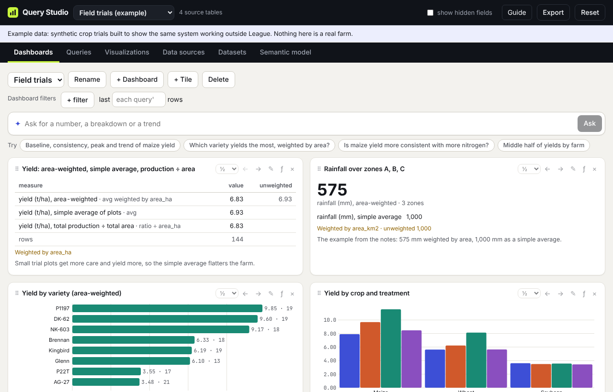

# Query Studio user guide

Query Studio lets you ask your own questions of your own data and keep the answers. You load a table, describe which columns are things to slice by and which are numbers to add up, build a query, pick how to draw it, and pin it to a dashboard. Every piece is saved and reusable, so one query can feed several charts and one chart can sit on several dashboards.

The app ships with two example workspaces. **League of Legends** holds a player's match history, the people they played with and against, and baselines for comparison. **Field trials** is synthetic crop data loaded from a CSV, an Excel sheet and a nested JSON file, there to show that nothing in the system is specific to League.

Open it at **https://bijanp24.github.io/query-studio/**, or see [Where it runs](where-it-runs.md) for running a copy on your own machine.



## Start here

1. [Getting started](getting-started.md): the screen layout, workspaces, and a five-minute tour.
2. [Bring your own data](your-data.md): upload CSV, JSON or Excel, merge tables into a dataset, and name your fields.
3. [Build a query](queries.md): measures, filters, grouping, weights, comparisons and trends.
4. [Choose a visualization](visualizations.md): the 15 tile types and when each one fits.
5. [Assemble a dashboard](dashboards.md): tiles, widths, drag and drop, and dashboard-wide filters.
6. [Ask and suggested questions](ask.md): type a question in plain English and get a query back.
7. [Read the Player profile](player-profile.md): Baseline, Consistency, Peak and Trend.
8. [Where it runs](where-it-runs.md): GitHub Pages, your own machine, and claude.ai, and where your work is saved.

## The idea in one picture

```
Data source ──► Data source item ──► Dataset ──► Fields ──► Query ──► Visualization ──► Dashboard
(a file,        (one table:          (the       (dimensions,  (a saved     (how one query   (a page of
 an upload,      a sheet, a JSON      processed   measures,     question)    is drawn)        tiles)
 a warehouse)    array, a CSV)        layer)      weights)
```

Each link is by name, so any query can feed any visualization and any visualization can sit on any dashboard. The tabs across the top of the app follow the same chain, read right to left: Dashboards, Queries, Visualizations, Data sources, Datasets, Semantic model.

## Words used in this guide

| Word | Meaning |
| --- | --- |
| Workspace | Everything for one subject: its sources, datasets, queries, visualizations and dashboards. Switch workspaces in the menu at the top left. |
| Data source | Where data comes from: a file you uploaded, a table you typed in, files published with the app, or (later) a warehouse. |
| Data source item | One table inside a source, such as one Excel sheet or one array inside a JSON file. |
| Dataset | A clean table built from one or more items, in priority order. Queries read datasets. |
| Grain | What one row of a dataset is: a game, a player, a plot. |
| Sequence | The column that puts rows in order, usually a date. It makes "last 20 games", rolling windows and trends possible. |
| Dimension | A column you slice by: champion, role, crop, month. |
| Measure | A number you aggregate: win rate, CS per minute, yield. |
| Weight | A rule for how much each row counts, such as "support games count half". |
| Query | A saved question: which dataset, which measures, which rows, grouped how. The Queries tab lists them under the heading "Data source items". |
| Visualization | How one query is drawn: a KPI number, bars, a line, a player card. |
| Dashboard | A page of visualization tiles with shared filters. |

## Coming next

Two additions are in progress and will get their own sections here when they land:

- **Rank-distribution dashboards**: where the players you meet sit on the ladder, as ready-made dashboards.
- **Baseline, Consistency, Peak and Trend as separate visualization types**, so each of the four numbers can be its own tile. Today they come together on the Player card (see [Read the Player profile](player-profile.md)).

Developers looking for how the engine, SQL compiler and processed layer work should read [ARCHITECTURE.md](../ARCHITECTURE.md) instead.
