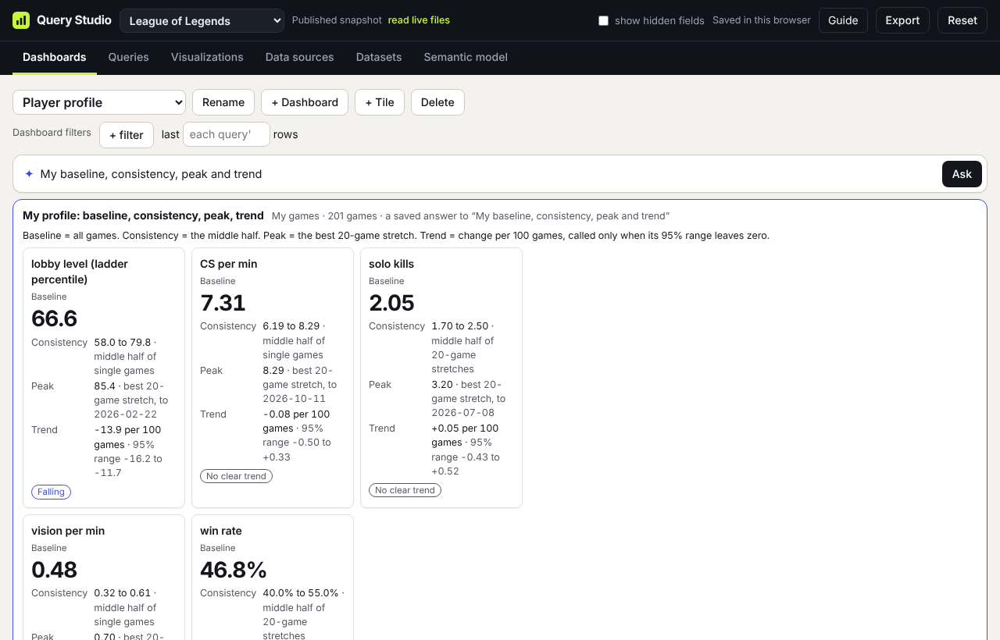

# Ask and suggested questions

[← Guide contents](README.md)

The Ask box sits at the top of every dashboard and of the Queries tab. Type a question the way you would say it, and Query Studio builds the query and picks a visualization for it. You see the answer before anything is saved.

## Suggested questions

Under the Ask box, a row of **Try** chips shows questions the workspace was built to answer. They are the quickest way in for a new user.

There are two kinds:

- **Saved answers.** Chips such as "My baseline, consistency, peak and trend" or "Which variety yields the most, weighted by area?" open a ready-made visualization at once, with no waiting. They work everywhere, including on GitHub Pages and on your own machine. You can **Add to dashboard**, **Open in the builder** to see and change how it is built, or **Ask Claude instead** for a fresh answer.
- **Open questions.** Chips such as "Is my CS per min more consistent on Gangplank than on my other champions?" go to Ask, because there is no saved answer for them. These need claude.ai (see below).

## Asking your own question

1. Type in the box, for example `win rate by champion, Riven games after the 150th count double`, and press **Ask**.
2. The answer appears under the box: the chart, which dataset it read, how many rows it covers, any weighting, a sentence explaining what was built, and a list of anything that was adjusted ("Adjusted: …") to fit the data.
3. Then choose:
   - **Add to dashboard**: saves the query and visualization and adds the tile to the dashboard you are on.
   - **Save query and visualization**: saves both without adding a tile.
   - **Open in the builder**: saves the query and opens it on the Queries tab, so you can check every setting.
   - **Discard**.

Asked from the Queries tab, the answer is saved as a new query and selected in the list.

## What Ask understands

Ask reads the workspace's datasets, fields, descriptions, weighting schemes and sample values, so it can use anything the query builder can:

- Measures, aggregations and formulas: "KDA", "median CS per minute", "solo kills minus my opponent's".
- Filters and windows: "last 50 ranked solo games", "on Gangplank", "top lane only".
- Grouping, top N and minimum sizes: "by champion, at least 5 games, top 10".
- Weights: "support games count half", "weighted by game length", "my highlighted games count double".
- Comparisons: "vs my lane opponents", "vs lobby players in the same role", "vs the 50 games before", "vs 50%".
- Trends: "rolling 20-game average", "is it rising", "change vs the previous 20", "running total".
- The Player profile: "my baseline, consistency, peak and trend", "my peak 20-game stretch for solo kills".

Hidden fields, such as rank in League, are left out unless **show hidden fields** is on.

## When Ask gets it wrong

Every answer is checked against the workspace before you see it. Fields, formulas, weights and datasets that do not exist are repaired where possible, listed under "Adjusted", or refused with a message. If an answer is close but not right, click **Open in the builder** and fix the one setting; that is usually faster than rephrasing.

## Where Ask works

Ask needs Claude, so it works when Query Studio is opened as an artifact on claude.ai. On GitHub Pages or a copy on your own machine, typing a question shows "Ask needs Claude, which this view does not offer". Suggested questions with saved answers, the query builder and everything else still work there. See [Where it runs](where-it-runs.md).

Next: [Read the Player profile](player-profile.md)
