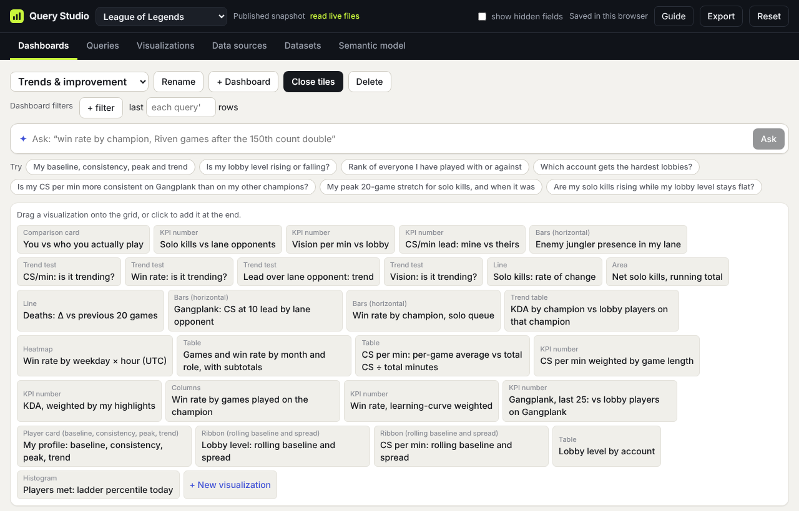

# Assemble a dashboard

[← Guide contents](README.md)

A dashboard is a page of tiles, each one a saved visualization. Dashboards have their own filters, so one page can answer "the same questions, but only for Gangplank" without touching the queries underneath.

## The dashboard bar

| Control | What it does |
| --- | --- |
| Dashboard menu | Switch dashboards in this workspace. |
| Rename | Edit the name in place; click **Done** when finished. |
| + Dashboard | Start an empty dashboard and open the tile drawer. |
| + Tile | Open the drawer of saved visualizations. |
| Delete | Asks first, then removes the dashboard. Its visualizations and queries stay. |

## Add tiles

Click **+ Tile**. Every saved visualization appears as a chip showing its type and name.

- **Click** a chip to add it at the end.
- **Drag** a chip onto the grid to place it before a tile, or onto "Drop here to place at the end".
- **+ New visualization** jumps to the Visualizations tab to make one first.

You can also add a tile straight from **Ask** or from a suggested question with **Add to dashboard** (see [Ask](ask.md)).

## Arrange tiles

Each tile's header has its tools:

| Tool | What it does |
| --- | --- |
| ⠿ (grip) | Drag the tile by its header to move it. |
| Width menu | ⅓, ½, ⅔ or full width, for this tile on this dashboard. |
| ← → | Move one place earlier or later; handy on a phone or with a keyboard. |
| ✎ | Edit the visualization. |
| ƒ | Edit the query. |
| × | Remove the tile from this dashboard. The visualization stays saved. |

On a narrow screen the grid stacks tiles in one column.

## Filter the whole dashboard

**Dashboard filters** apply to every tile whose query reads a dataset with that field, on top of the query's own filters. Click **+ filter**, pick a field (only dimensions used by this dashboard's tiles are offered), an operator and a value.

**last N rows** overrides each query's own window. Leave it empty to keep each query's own; set it to 20 to see the whole dashboard over your last 20 games.

Typical uses in League: filter `champion = Gangplank` on Trends & improvement, or `position = TOP` on the Lobby lens.

A query can opt out: untick **follow the dashboard’s filters and window** next to its Window setting in the query builder.

## Reading tiles

- A tile's title is the visualization's name; hover it to see the query's name.
- Comparisons read "▲ +0.84 vs lobby players, same role (6.41)". Green is better and red is worse, according to the measure's "Better when" setting.
- Weighted tiles say what they are weighted by; single-number tiles also show the unweighted value.
- The line under a tile is its note. Edit it with ✎.

## Build a dashboard from scratch

1. **+ Dashboard**, then **Rename** it.
2. On **Queries**, build or **Duplicate** the queries you want and click **Make a visualization** on each.
3. Back on the dashboard, **+ Tile** and click each new visualization.
4. Set widths: KPIs at ⅓, charts at ½, tables and cards full.
5. Add a dashboard filter if the whole page is about one slice.

Next: [Ask and suggested questions](ask.md)
