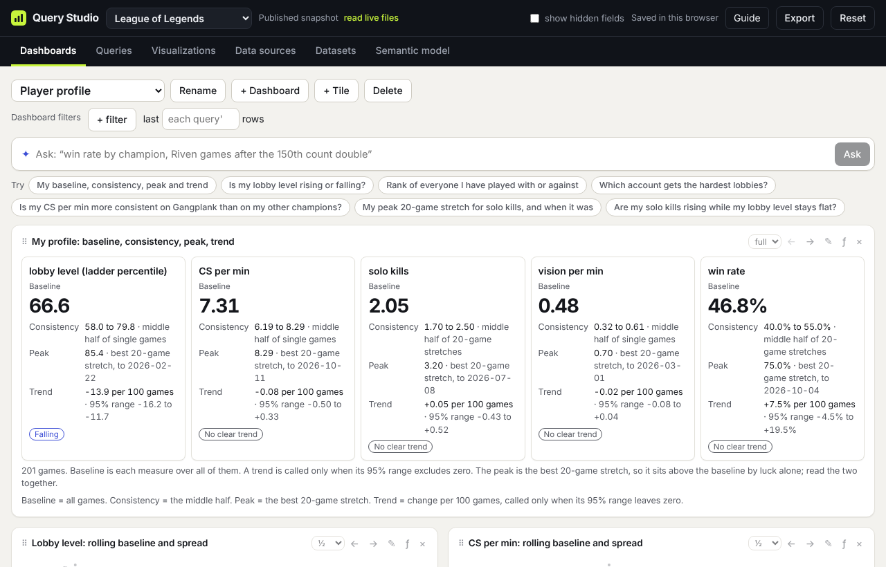

# Read the Player profile

[← Guide contents](README.md)

A single average hides most of what matters about a player. Two players can both average 7 CS per minute while one is steady and the other swings between 5 and 9; one may be climbing while the other is sliding. The Player profile describes any measure with four numbers instead of one: **Baseline, Consistency, Peak and Trend**.

It works on anything measured over rows in order: a player over their games, a field plot over its plantings, a store over its weeks. The Field trials workspace has the same card for maize yield.

## Where to find it

- **League**: Dashboards → **Player profile**, or the suggested question "My baseline, consistency, peak and trend".
- **Field trials**: the "Maize: baseline, consistency, peak, trend" tile, or the suggested question about maize yield.
- **Any query**: pick the **Player card** or **Ribbon** type for a query with no group-by on a dataset with a sequence.

## The four numbers

| Number | What it is | How to read it |
| --- | --- | --- |
| **Baseline** | The measure over every row in the query, with its own aggregation and weights. | Your level. This is the number to compare with other people. |
| **Consistency** | The middle half: from the 25th to the 75th percentile. | A narrow range means you play to your baseline most games. A wide one means the baseline is an average of good and bad days. |
| **Peak** | The best stretch of N rows (20 games by default) and the date it ended. | What you look like at your best. It always sits above the baseline by luck alone, so read the two together; a peak far above a baseline is a hot streak, not a new level. |
| **Trend** | The change per 100 games, from a straight line fitted through every game, with a 95% range. | A verdict appears only when the whole range is on one side of zero: **Improving** or **Declining** (or Rising and Falling for measures with no better direction). Otherwise it says **No clear trend**, which usually means "not enough games yet to tell". |

**Why consistency is measured two ways.** For a median, a percentile, min or max, the middle half is taken over single games. For an average, a rate, a sum or a ratio it is taken over rolling stretches, because a single game's win is 0 or 1 and its spread says nothing. The card says which ("middle half of single games" or "middle half of 20-game stretches").

## The Ribbon

The Ribbon draws the same idea over time: a line for the rolling baseline, a shaded band for each stretch's middle half, and a ring on the peak. Use it to see when a change happened, not just whether it did. It needs more rows than its window.

## The rest of the League Player profile dashboard

| Tile | What it shows |
| --- | --- |
| My profile: baseline, consistency, peak, trend | The four numbers for lobby level, CS per minute, solo kills, vision per minute and win rate. |
| Lobby level: rolling baseline and spread | A ribbon of how strong your lobbies are. |
| CS per min: rolling baseline and spread | A ribbon of your farming. |
| Players met: ladder percentile today | A histogram of where everyone you have played with or against sits on the ladder. 50 is the median ranked player. |
| Lobby level by account | Median and quartiles of lobby level for each of your accounts. |

**Lobby level** is where the other nine players in a game sit on the ranked ladder, as a percentile from 0 to 100 (enemies weighted slightly more than allies). It uses each player's rank as of the latest data pull, because the Riot API only gives current rank. Daily rank snapshots started on 2026-10-18; as they build up, lobby level can use the rank each player held at the time of the game.

## Make your own

1. On **Queries**, start a query on a dataset with a sequence (League: My games). Add the measures you care about. Use **median** for per-game stats like CS per minute, and leave rates like win rate as they are.
2. Leave **Group by** empty and **last N** at 0 (or set it, to profile only recent games).
3. Add filters, such as one champion or one queue, and a weighting if you want one.
4. **Make a visualization**, set the type to **Player card**, and set **Rolling window** to the stretch length you want for Peak and Consistency.

The card makes a fair comparison easy: duplicate the query, filter it to another champion or account, and put the two cards side by side.

## Coming next

Baseline, Consistency, Peak and Trend are being split into separate visualization types, so each can be its own tile and be compared across champions or accounts. This page will cover them when they land.

Next: [Where it runs](where-it-runs.md)
