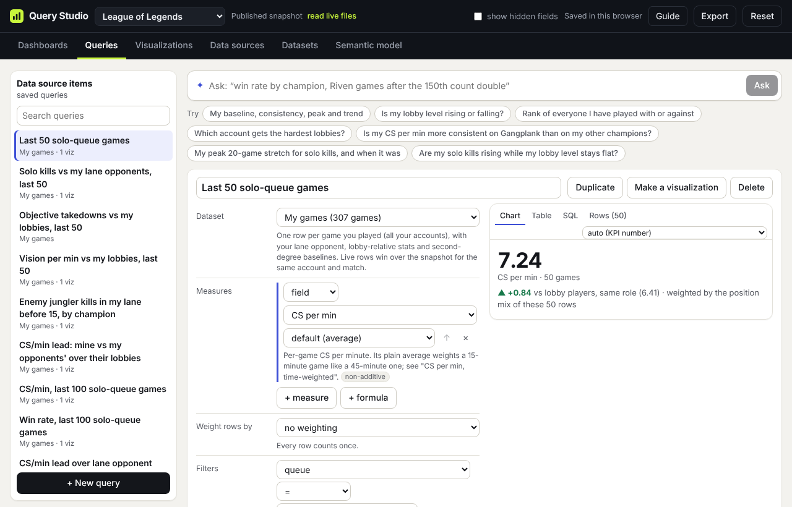

# Build a query

[← Guide contents](README.md)

A query is a saved question. It names a dataset, the numbers to compute, which rows count, how to split them, and what to compare against. Queries are where Query Studio differs from a fixed stats page: instead of "your last 20 games", you decide the window, the weights and the comparison.



## The builder

Open the **Queries** tab. Saved queries are listed on the left, with a search box; click **+ New query** at the bottom to start one, or **Duplicate** on an open query to start from it. The form is in the middle and a live preview on the right.

Work down the form:

### Dataset

What you are asking about. In League, **My games** is your own games; **Lobby players' games** is the reference population; **Players met** is one row per person. Changing the dataset clears the rest of the form.

### Measures

The numbers to compute. Each measure is either a **field** (pick one; "count of rows" is always available) or a **formula** (type one, such as `cs_per_min - opp_cs_per_min`, and give it a label). Then choose the aggregation, or leave it on the field's default:

| Aggregation | Use it for |
| --- | --- |
| average, sum, count of rows | The usual. |
| median | A typical game, not pulled around by one outlier. |
| 25th and 75th percentile, middle-half spread | How wide a stat swings. |
| min, max | Best and worst single rows. |
| rate | Share of rows where a 0/1 value is 1, such as win rate. |
| ratio of sums | Total of one thing over total of another, such as total CS ÷ total minutes. Formulas get a ÷ box for the denominator. |
| count of values, distinct count | How many rows have a value, or how many different values there are. |

Add more with **+ measure** or **+ formula**. The first measure is the primary one: charts, sorting and comparisons use it. Under each measure a badge says whether it is additive, so you know if it can be summed across groups.

### Weight rows by

By default every row counts once. Pick a weighting scheme from the list (League ships with learning curve, main role counts double, support games count half, game length, and my highlights), or choose a custom formula such as:

```
if(champion = 'Riven' and champ_game_no > 150, 2, 1)
```

A weighted average is Σ(value × weight) ÷ Σ weight. Rows with no value or no weight drop out of both sides. Tiles always say a result is weighted, and single-number tiles show the unweighted value next to it, so a weighting cannot quietly flatter a number.

### Filters

Which rows count. Each filter is a field, an operator (=, ≠, >, <, ≥, ≤, in list, contains, is empty, is not empty) and a value. The value box suggests values from the data. For **in list**, separate values with commas.

### Window

On datasets with a sequence, **last N** keeps the most recent N rows after filtering. 0 means all of them. "Last 50 ranked solo games" is a filter on queue plus last 50. The tick box next to it, **follow the dashboard’s filters and window**, decides whether dashboard filters apply to this query (on by default).

### Group by

Split the result by up to two dimensions. Time columns get a grain: hour of day, day, weekday, week, month, quarter or year. Two group-bys give you a table, stacked bars or a heatmap.

Once grouped, a **Groups** row appears:

- **Sort**: most rows first, highest value, lowest value, or by name and time.
- **top N**: keep only the best N groups. With two group-bys, it keeps the best N of the second within each of the first ("best two varieties per crop").
- **at least N rows**: hide groups too small to trust, such as champions played twice.
- **subtotals and total (ROLLUP)**: add a subtotal per first group and a grand total.
- **+ having**: keep groups whose measure passes a test, such as win rate ≥ 0.55.

### Series

On datasets with a sequence, turn one number into a running view along time. The tile shows the latest value and line charts show every step.

| Series | Question it answers |
| --- | --- |
| rolling aggregate | What was my average over each 20-game stretch? |
| change vs previous window (Δ) | Am I better than I was 20 games ago? |
| rate of change (d/dt, slope) | How fast is it moving, per 10 games? |
| running total (∫) | What has piled up so far, such as net solo kills? |

### Compare with

Every number reads better next to another one. Choose:

| Compare with | Example |
| --- | --- |
| the window before (previous N) | My last 50 games against the 50 before. Needs a "last N" window. |
| a fixed target | Win rate against 50%. |
| another column, same rows | My CS per minute against my lane opponent's in the same games. |
| another dataset (reference population) | My CS per minute against lobby players in the same role. |

For a reference population, add filters for which reference rows count, then pick dimensions under **Like for like**. Picking position means the reference is weighted by how often you play each role, so a mostly-top player is compared against top laners, not against everyone.

## The preview

The right-hand panel has four views:

- **Chart**: the result drawn automatically, or in a type you pick from the menu.
- **Table**: every number in the result.
- **SQL**: what a warehouse would run for this query, in DuckDB, PostgreSQL, Redshift or BigQuery syntax. The browser runs the same plan; the two are tested to give the same numbers. **Copy SQL** copies it.
- **Rows**: the rows behind the result, newest first. In League, this is where you star games, give them a weight, and add tags and notes. Those highlights feed the "My highlights" weighting and the `highlighted = 1` filter straight away.

Warnings, such as a measure that cannot be weighted, show at the top of the preview.

## Saving and reuse

Queries save as you type. **Make a visualization** creates a tile from the current query and opens it on the Visualizations tab. **Delete** asks first and also removes the visualizations built on the query.

A query keeps its own window and filters, and it also follows the filters of whichever dashboard shows it (see [Assemble a dashboard](dashboards.md)).

## Recipes

| You want | Set |
| --- | --- |
| Win rate by champion, champions with 5+ games only | Measure win (rate) · Group by champion · at least 5 rows · sort most rows first |
| My last 30 games on one champion against lobby players on that champion | Filter champion = X · last 30 · Compare with another dataset, Lobby players' games, like for like on position and champion |
| CS per minute that counts every minute equally | Weight rows by Game length, or measure CS with aggregation ratio ÷ duration_min |
| Am I dying less than I used to? | Measure deaths · last 100 · Series: change vs previous window, 20 |
| Riven games after the 150th count double | Weight rows by custom: `if(champion = 'Riven' and champ_game_no > 150, 2, 1)` |
| Best two varieties per crop | Group by crop, then variety · sort highest value · top 2 |

Next: [Choose a visualization](visualizations.md)
