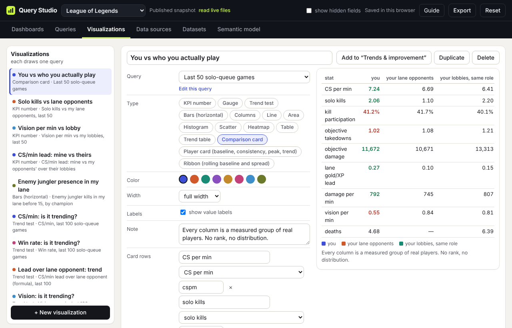

# Choose a visualization

[← Guide contents](README.md)

A visualization is how one query is drawn. Any query can feed any visualization, and a query can have several (a KPI on one dashboard, a trend line on another). If a type does not fit the query's shape, the tile says so instead of guessing, for example "A heatmap needs a query grouped by two fields."

## Make one

- From a query: open it on **Queries** and click **Make a visualization**.
- From scratch: on **Visualizations**, click **+ New visualization** and pick its **Query**.
- From Ask: **Save query and visualization** or **Add to dashboard** saves both (see [Ask](ask.md)).

Then set:

| Setting | What it does |
| --- | --- |
| Query | Which saved query it draws. **Edit this query** jumps to it. |
| Type | One of the 15 types below. |
| Color | One of eight colours that read in light and dark mode. |
| Width | The default tile width: a third, half, two thirds or full. A dashboard can override it per tile. |
| Labels | Show values on bars and points. |
| Rolling window | For Trend test, Trend table, Player card and Ribbon: the stretch length, such as 20 games. |
| Horizontal axis | For Scatter: the field across the bottom. |
| Note | A line under the tile telling the reader what to take from it. Use it. |

The editor previews the tile as you go. **Add to "…"** puts it on the dashboard you last had open; **Duplicate** copies it so you can try another type side by side.

## Which type fits

### One number

| Type | Fits | Notes |
| --- | --- | --- |
| **KPI number** | Any query without a group-by | Big number, how many rows it covers, the comparison as ▲ or ▼ in green or red, and any extra measures in a small table below. With a series, shows the latest value. |
| **Gauge** | One number with a natural range | A dial; percentages run 0 to 100%, others span the data. The comparison is marked on the dial. |
| **Trend test** | A measure over a "last N" window on a dataset with a sequence | Each row, the rolling average, and a least-squares line, with a verdict: improving, declining, leaning better or worse, or no clear trend, and how confident that is. Needs at least six rows. |

### Comparing groups

| Type | Fits | Notes |
| --- | --- | --- |
| **Bars (horizontal)** | One group-by with many or long labels | The default for "by champion" or "by variety". |
| **Columns** | One group-by with few labels, or two group-bys | Two group-bys draw grouped columns. |
| **Heatmap** | Exactly two group-bys | Weekday × hour, farm × crop. |
| **Table** | Anything | Every value, with subtotals when the query has ROLLUP, and the unweighted value when it is weighted. |
| **Trend table** | One group-by on a dataset with a sequence | One row per group with its value, comparison and a small line of its rolling value. |
| **Comparison card** | A query whose rows you want to measure several ways | Rows are measures; columns are groups such as "you", "your lane opponents" and "your lobbies, same role". Each column is this query's rows, a paired column on the same rows, or a reference dataset. Set them under **Card rows** and **Card columns**. |

### Over time

| Type | Fits | Notes |
| --- | --- | --- |
| **Line** | A time group-by, or any series (rolling, change, slope, running total) | |
| **Area** | The same, where the filled shape helps, such as a running total | |
| **Ribbon** | A measure over a dataset with a sequence | The rolling baseline as a line, each window's middle half shaded, and the peak ringed. See [Player profile](player-profile.md). |

### Spread and relationships

| Type | Fits | Notes |
| --- | --- | --- |
| **Histogram** | One measure over many rows | How the values are spread. Needs at least three rows. "Players met: ladder percentile today" is one. |
| **Scatter** | One measure against another field | Set **Horizontal axis**. Maize yield against nitrogen is one. |
| **Player card** | One or more measures, no group-by | Baseline, Consistency, Peak and Trend for each measure. See [Player profile](player-profile.md). |

If you are unsure, leave the preview on **auto** in the query builder. It picks a KPI for a single number, a line for a series, bars for one group-by (columns when it is by time), and for two group-bys a heatmap when one is by time or a table otherwise.

## Weighted results are always labelled

When a query is weighted, the tile says so ("Weighted by area_ha"). KPI tiles show the unweighted value next to it and tables add an "unweighted" column. You can weight to make a fair comparison, but the plain number is always one glance away.

Next: [Assemble a dashboard](dashboards.md)
