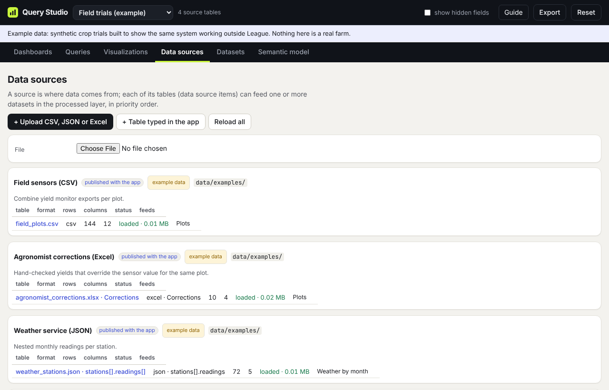
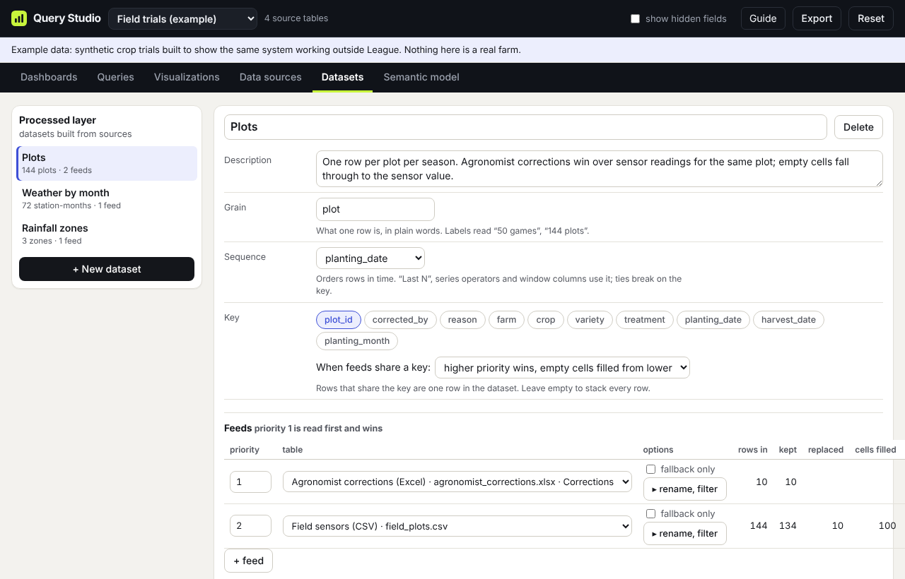
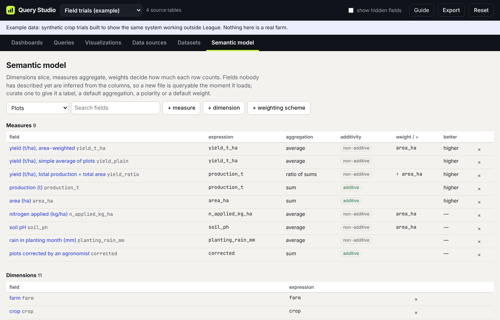

# Bring your own data

[← Guide contents](README.md)

Three tabs turn a file into something you can query: **Data sources** (get the table in), **Datasets** (shape it), and **Semantic model** (say what the columns mean). For a single clean file you only need the first step; the other two are there when you want more.

## 1. Start a workspace (optional)

You can add files to an example, but a new subject is easier to keep tidy in its own workspace. In the workspace menu choose **+ New workspace…**, type a name, and click **Create workspace**. You land on Data sources.

## 2. Upload a file



1. On **Data sources**, click **+ Upload CSV, JSON or Excel** and choose a file. CSV, TSV, plain text, JSON, JSON Lines, and Excel (.xlsx, .xls, .xlsm) all work.
2. Check **Read as**. It is guessed from the file name.
3. For **Excel**, pick the **Sheet**.
4. For **JSON**, pick **Records**: the array that holds one record per row. If each record holds its own list (a weather station with monthly readings, say), choose **explode** to get one row per inner item, with the outer record's fields copied onto each.
5. Give the table a **Name** and look at the preview. Column types (number, text, time) are detected for you.
6. Leave **also create a dataset from it** ticked, and click **Add table**.

The app opens the new dataset on the Datasets tab. It is already queryable: go to Queries and pick it.

**Limits.** Everything runs in your browser, so each upload is capped at 8 MB of text. Larger data belongs in a warehouse source, which needs the query server that is not built yet; the **Connectors that need the query server** list at the bottom of Data sources shows which ones are planned (Redshift, PostgreSQL, Snowflake, BigQuery, DuckDB and MotherDuck, and REST APIs).

## 3. Or type a small table

For a short list such as targets, zone areas, or notes, click **+ Table typed in the app**. Give it a name and its columns, comma separated, with `:number` after numeric ones:

```
zone, area_km2:number, rainfall_mm:number
```

The first column is the key. Open the table in the list to type rows; every dataset that uses it rebuilds as you edit.

## 4. Shape a dataset (when you need to)



A dataset is the clean table your queries read. Open one on the **Datasets** tab to set:

| Setting | What it does |
| --- | --- |
| Description | Plain words about the table. Ask reads it. |
| Grain | What one row is ("game", "plot"). Tiles say "50 games" instead of "50 rows". |
| Sequence | The column that orders rows, usually a date. Needed for "last N", rolling windows, trends and the Player profile. |
| Key | The columns that identify a row. Rows sharing a key become one row. Leave it empty to stack every row. |
| Feeds | The tables that fill the dataset, in priority order. Priority 1 wins. |
| When feeds share a key | **Replace** keeps the higher-priority row. **Coalesce** keeps it but fills its empty cells from lower-priority rows. |
| Lookups | Joins columns in from another table on matching columns, like a spreadsheet VLOOKUP. |
| Derived columns | New columns from a formula, such as `(kills + assists) / max(deaths, 1)`. Window columns run along the sequence: row number, running sum, running average, previous value. |

**Merging two files.** Add both as feeds of one dataset, set a key, and give the more trusted file priority 1. In Field trials, hand-checked yields from the agronomist's Excel sheet override the sensor readings for the same plot this way. The feeds table shows rows in, kept, replaced and filled for each feed, so you can see what the merge did.

**Fallback feeds.** Tick **fallback only** on a feed to read it only when every higher-priority feed is empty. The League workspace uses this to prefer live files and fall back to the published snapshot.

**Build SQL for a warehouse** at the bottom shows the same merge as one `CREATE TABLE` statement, for when the data moves to a database.

## 5. Name your fields (when you want to)



Every column is usable straight away: numbers become **measures** and everything else becomes a **dimension**. The **Semantic model** tab is where you make them read well and behave correctly. Click **Curate** on a field to edit it:

- **Label** and **Description**: what people and Ask see.
- **Role**: dimension, measure, or weight.
- **Aggregation**: how a measure combines by default (average, sum, median, rate, ratio and others).
- **Better when**: higher, lower, or neither. This colours comparisons green or red and decides what counts as a peak.
- **Additivity**: whether the measure can be summed across groups. A per-game average is not additive; total gold is.
- **Default weight** and **Denominator**: for measures that should be averaged by something other than "each row once", such as yield averaged by area.
- **Format**: number, percent and so on.

Use **New measure**, **New dimension** and **New weighting** to add fields defined by a formula. A **weighting scheme** is a named rule that appears under "Weight rows by" in every query on that dataset; the League workspace has five, from "Support games count half" to "My highlights".

Tick **hidden** on a field to keep it out of the pickers and out of Ask unless **show hidden fields** is on.

## Formulas

Formulas in derived columns, measures, weights and filters share one small language:

- Columns by name, numbers, `'text'`, `+ - * /`, comparisons, `and`, `or`, `not`.
- `if(cond, a, b)`, `decode(x, 'a', 1, 'b', 2, default)`, `coalesce(a, b)`, `nullif(a, b)`
- `min(a, b)` and `max(a, b)` across columns, `round`, `abs`, `floor`, `ceil`, `sqrt`, `pow`, `log`, `ln`, `exp`
- `lower`, `upper`, `split_part(text, '#', 1)`
- `hour`, `weekday`, `date`, `month`, `year` of a time column

Division by zero gives an empty value rather than an error. Each formula box shows whether it can read your formula and which columns it uses.

Next: [Build a query](queries.md)
